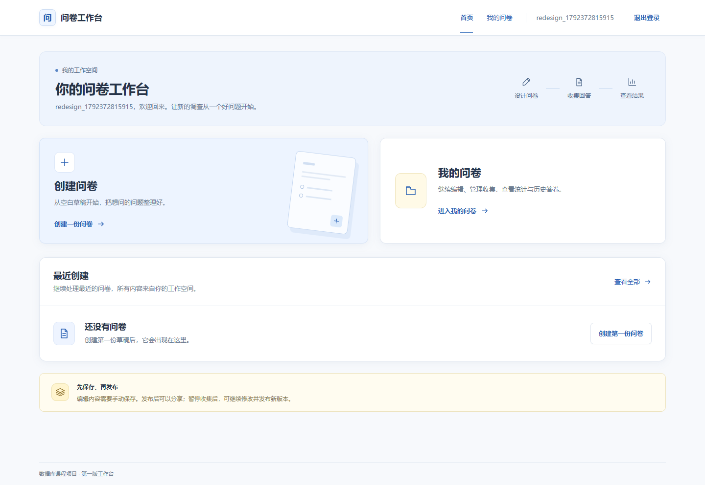
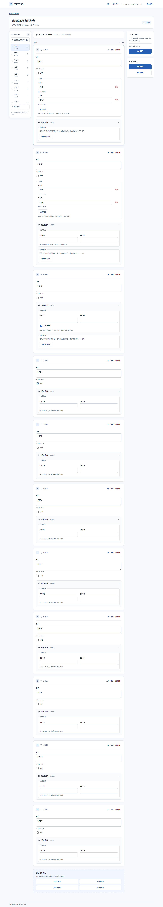
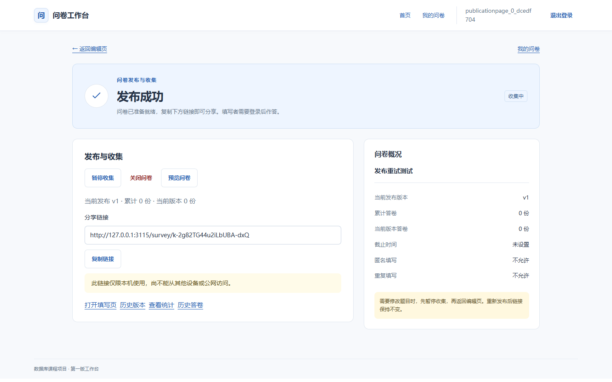
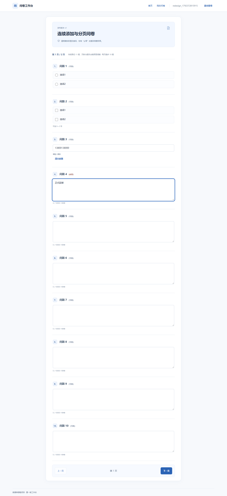
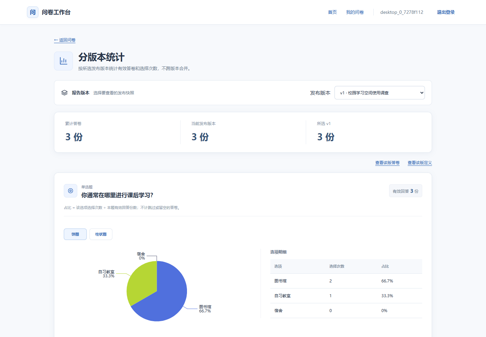

# 系统页面展示

[← 返回项目README](../README.md)

本页展示已实现页面，截图直接引用已有浏览器测试证据，没有重新生成或修改图片。账号、题目与答卷均为测试样例；工作台空态和统计样例来自不同测试过程，不能合并核对数量。

## 工作台

登录后进入工作台，可创建问卷或查看自己的问卷。截图展示新测试账号尚未创建问卷时的状态。

## 题目编辑

目录、题目编辑区和保存发布区分别布局，支持四种题型、校验与跳转配置。以下为11题测试问卷的完整长截图，展开后可查看底部添加入口。

展开题目编辑器完整截图

## 发布与收集

发布确认成功后进入此页，首屏展示分享链接和复制按钮，并可暂停、关闭或进入统计与历史。截图中127.0.0.1和3115为专项测试地址，不是公网服务地址。

## 分页填写

同一白色内容区连续展示题目，每页最多10道有效题，保留原始题号。截图中的13800138000为整数精度专项使用的合成测试值。

展开分页填写完整截图

## 分版本统计

展示版本选择、累计/当前/所选版本答卷份数及选项图表和明细。图中3份答卷属于独立测试样例，选项次数与占比用于验证页面展示。

## 截图来源

- 工作台、编辑与填写：2026-10-19[浏览器回归日志](testing/runs/2026-10-19T01-20-14-041Z-browser/output.log)及[页面检查结果](testing/screenshots/redesign-1792372815915/result.json)。
- 发布页：2026-10-19[发布页专项记录](testing/publication-page.md)。
- 统计页：既有[桌面精修记录](testing/desktop-polish.md)，图片位于`desktop-polish-1792248909347/after/`。

本页用于展示界面，完整测试步骤与实际结果见[正式测试用例](testing/submission-test-cases.md)。运行方法见[README配置与启动](../README.md#配置与启动)。
